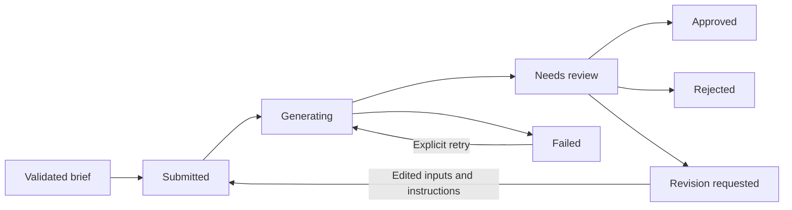
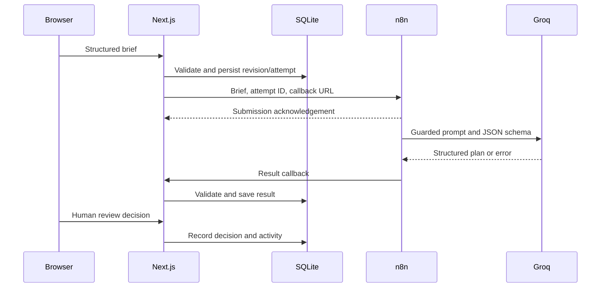

# Campaign Brief Studio

A local AI automation demo that turns a structured business brief into a campaign draft for human review. Built with Next.js, TypeScript, SQLite, and an importable n8n workflow.

The workflow captures inputs, validates them, tracks generation attempts, saves structured plans, and records approval, rejection, or revision decisions. It does not publish campaign content automatically.

## What it produces

- Brief summary and audience insights
- Exactly three messaging angles
- Landing-page outline and seven-day content plan
- Assumptions, risks, confidence, and questions for a reviewer
- Revision history and an activity log

The five main pages are Dashboard (`/`), New Brief (`/briefs/new`), Brief Detail (`/briefs/[id]`), Review Queue (`/review`), and Workflow & Settings (`/settings`).

## Quick start: local demo

Requires Node.js **22.20 or later**, npm, and a writable local disk. SQLite uses the native `better-sqlite3` dependency.

From the project directory:

```powershell
npm ci
Copy-Item .env.example .env.local
npm run dev
```

Copy the environment template only on first setup; preserve an existing `.env.local`. Open [Campaign Brief Studio](http://127.0.0.1:3000).

Leave `N8N_WEBHOOK_URL` blank for deterministic demo generation. This mode requires neither n8n nor a provider key. It exercises validation, persistence, review, and revision behavior, but its output is a local template, not an LLM response.

To run a production build locally:

```powershell
npm run build
npm start
```

Both npm server commands bind to `127.0.0.1`.

## Integration status

| Capability | Current implementation |
| --- | --- |
| Local demo generation | Deterministic plan generator; no external API call |
| Persistence | Transactional SQLite, including revisions, attempts, plans, and activity |
| Live generation | App submits to n8n; n8n calls Groq and posts a result callback |
| Provider | Groq chat completions; exported model is `openai/gpt-oss-120b` |
| OpenAI / Claude APIs | Not implemented by the current adapter; the OpenAI model name above is served through Groq |
| Human review | Approve, reject, or request revisions; no automatic publishing |
| Approval notification | Optional n8n → Slack branch; delivery is best effort |
| Authentication | No user accounts; intended for a local operator |

The current implementation has moved beyond the earlier synchronous OpenAI design. Some companion documentation and node notes still describe that older design. This README describes the current source; it does not establish that a live provider round trip has passed.

## Environment configuration

Set app variables in `.env.local`; restart the app after changing them. Never use a `NEXT_PUBLIC_` prefix for secrets.

| Variable | Purpose |
| --- | --- |
| `N8N_WEBHOOK_URL` | Production generation webhook URL. Blank enables local demo mode. |
| `N8N_WEBHOOK_SECRET` | Required in webhook mode; must match the n8n inbound Header Auth credential. |
| `CAMPAIGN_DB_PATH` | Optional database path; defaults to `data/campaign-brief-studio.sqlite`. |
| `APP_URL` | App base URL reachable **from n8n**, used to construct `/api/webhooks/generation-complete`. Defaults to `http://localhost:3000`. |
| `N8N_APPROVED_WEBHOOK_URL` | Optional approval notification webhook. |
| `SLACK_WEBHOOK_URL` | Optional **n8n environment** variable for its Slack notification node. |

The environment template currently lists the first three variables. Add optional variables only when needed. The code also recognizes `DEMO_MODE=true`, which bypasses mutation-origin checks; leave it unset for normal use.

Provider and model selection currently live in `scripts/workflow.ts`, not environment variables. Keep the Groq API key in a separate n8n credential.

## Configure n8n generation

1. Import [`n8n/campaign-brief-studio.json`](n8n/campaign-brief-studio.json). The export is inactive and contains no credentials.
2. On **Campaign webhook**, select a Header Auth credential with name `x-campaign-webhook-secret` and value matching `N8N_WEBHOOK_SECRET`.
3. On **Groq response**, select a different Header Auth credential: name `Authorization`, value `Bearer YOUR_GROQ_API_KEY`. The existing node note incorrectly mentions an OpenAI key; the request targets Groq.
4. Publish/activate the workflow and set its production webhook URL as `N8N_WEBHOOK_URL`.
5. Set `APP_URL` to an address n8n can reach. A container's `localhost` refers to that container, not the host machine. For n8n in Docker with the app on the host, configure suitable host networking/reachability; the app must actually listen on an interface reachable from that container.
6. Restart the app and submit a fictional brief. Confirm the workflow reaches **Callback result**, then verify the brief changes from Generating to Needs review.

n8n acknowledges submission immediately. The app waits up to 10 seconds for this acknowledgement; the provider HTTP node has a 35-second timeout. Generation completes through the callback, not through the initial webhook response. Attempts have a two-minute expiry used by retry and stale-result checks.

The provider request uses a strict JSON schema. The workflow parses and validates the provider response; the app validates the returned plan again before saving it. A configured webhook failure never silently falls back to demo generation.

### Current callback limitation

The callback route does **not** verify a shared secret or the contract version. The exported callback node also sends no authentication header. Local Host checks are not user authentication. Keep this MVP on a trusted local machine/network; authenticated callback verification is required before treating this as a shared deployment.

### Optional approval notification

Configure Header Auth on **Approved webhook**, set its production URL as `N8N_APPROVED_WEBHOOK_URL`, and configure `SLACK_WEBHOOK_URL` in n8n. Approval triggers a best-effort notification; successful approval is not proof of Slack delivery. Leave this branch unconfigured when it is not needed.

## Docker Compose

Requires Docker Desktop with Compose. Create `.env.local` first and set a shared webhook secret.

```powershell
docker compose up --build
```

Open the app at [127.0.0.1:3000](http://127.0.0.1:3000) and n8n at [127.0.0.1:5678](http://127.0.0.1:5678). Complete the import and credential steps above.

Compose runs both services. It overrides `N8N_WEBHOOK_URL` with `http://n8n:5678/webhook/campaign-brief-studio` and `APP_URL` with `http://campaign-brief-studio:3000`, so **Compose selects webhook mode even when the URL is blank in `.env.local`**. Use the npm quick start for a demo without n8n.

SQLite persists in `campaign-brief-data`; n8n persists in `n8n_data`. The app port is bound to loopback, but the current n8n mapping (`5678:5678`) binds on all host interfaces. Restrict that mapping before using this on an untrusted network. Do not use `docker compose down -v` unless you intend to delete persisted data.

## Review lifecycle



Approval and rejection are terminal decisions. Rejection and revision requests require notes. Low-confidence approval requires an acknowledgement and a note. Revisions retain prior inputs and plans; retries create another attempt for the same revision.

Mutations use idempotency keys, and review/retry/revision requests include the current brief version. Store operations guard against stale attempts replacing newer results. No authenticated reviewer identity is recorded.

## Architecture and storage



SQLite uses transactions, WAL, foreign keys, and operation receipts. Provider calls occur outside database transactions. A sibling legacy `briefs.json` can be imported on initial database setup; invalid records abort the import, and the original file is retained.

For a backup, stop the app and copy the entire data directory, including SQLite sidecar files. Local data and secret environment files are ignored by Git. Serverless filesystems and multi-machine shared-file deployments are outside this MVP's scope.

## Verification and maintenance

```powershell
npm run typecheck
npm run lint
npm test
npm run contract:check
npm run build
npm run test:production
```

`test:production` requires an existing production build and uses isolated test storage, a local server, and simulated webhook behavior. It does not replace importing the workflow into real n8n and testing with provider credentials. These commands are verification instructions, not a claim that the current working tree has passed them.

Edit the shared contract/provider code and workflow source, then regenerate checked-in artifacts:

```powershell
npm run contract:export
npm run contract:check
```

Re-import the workflow after regeneration and reselect deployment credentials. Main maintenance points:

- `src/lib/schema.ts` and `src/lib/validation.ts`: input/output contracts
- `src/lib/provider-contract.ts`: provider request and response adapter
- `scripts/workflow.ts`: n8n workflow source
- `src/lib/sqlite-store.ts`: persistence and state transitions
- `src/lib/webhook.ts`: submission and callback address
- `src/app/api/webhooks/generation-complete/route.ts`: callback processing

## Demo walkthrough

Use a fictional business, such as “Sample Studio,” with a fictional offer and no client data.

1. Show the dashboard and create a brief; demonstrate a missing-field validation message.
2. Submit the completed brief and explain whether deterministic demo mode or a live provider is active.
3. Review the angles, seven-day plan, assumptions, risks, and questions on the detail page.
4. Request a revision with notes, update the inputs, and inspect the history.
5. Approve or reject the resulting draft and show the activity log.

Generated content requires human review before external use. Audience insights are hypotheses unless supported by supplied evidence; no research connector is included. Never treat schema validity as factual accuracy or proof of compliance.

See also: [architecture](docs/architecture.md), [contract](docs/contract.md), [testing checklist](docs/testing-checklist.md), [Loom script](docs/demo-script.md), and [AI safety and limitations](docs/ai-safety-and-limitations.md). Companion documents may still contain details from the earlier synchronous OpenAI implementation; confirm integration details against the current source and this README.
