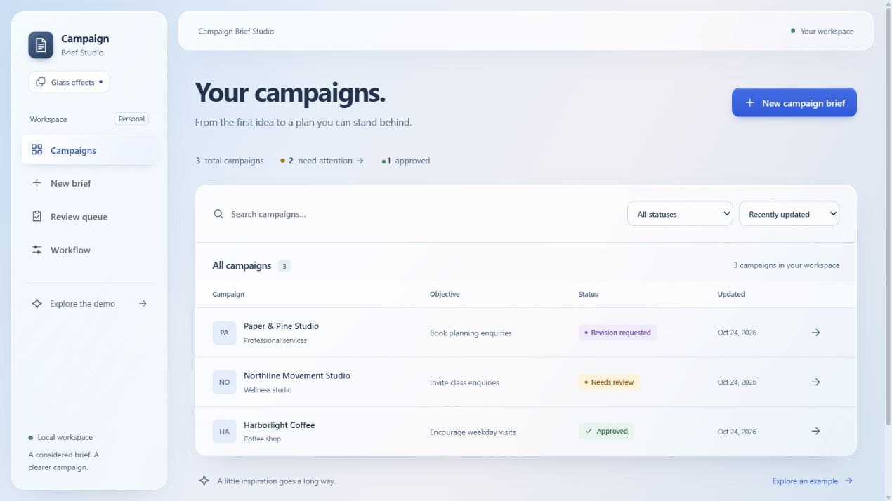
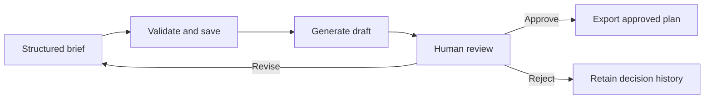

# Campaign Brief Studio

A considered workspace for turning a business brief into a campaign plan — with a human at the center.

Capture the audience, offer, and direction. Explore three messaging angles, a landing-page outline, and a seven-day content plan. Review the assumptions, request a revision, and export the version you approve. Every attempt and decision stays connected to its brief.

Built with **Next.js 16, React 19, TypeScript, transactional SQLite, and an importable n8n/Groq workflow**. The interface is designed for marketing work; the current operator application remains a local, single-user tool.



## Explore it locally

Requires Node.js **22.20 or later**, npm, and a writable local disk. Install dependencies and build:

```powershell
npm ci
npm run build
npm run preview
```

Open the [interactive demo](http://127.0.0.1:3100/demo) or [campaign workspace](http://127.0.0.1:3100). Preview mode creates a separate temporary database with explicitly fictional campaigns and disables generation webhooks and approval notifications. It never uses the operator database. Each preview run creates a new temporary workspace.

The `/demo` route itself keeps campaign interactions in client memory: examples, new briefs, deterministic generation, review, revisions, rejection, and approved export. Leaving or resetting the page discards campaign state. It does not call the operator API, read SQLite, or contact a provider.

The glass interface uses frosted surfaces, floating navigation, and crisp fields over a cool static backdrop. **Glass effects** in the navigation switches between glass and solid surfaces. The initial appearance respects the browser's reduced-transparency preference; an explicit choice is saved locally in this browser when storage is available. This stores only the appearance preference, separately from demonstration content.

For development, copy the template only if `.env.local` does not already exist:

```powershell
Copy-Item .env.example .env.local
npm run dev
```

Open [127.0.0.1:3000](http://127.0.0.1:3000). Leave `N8N_WEBHOOK_URL` blank to use deterministic local plans in the operator workspace. This mode saves actual local records and exercises the real review lifecycle; its output comes from templates, not an LLM. Use `npm start` after a build to run your configured operator workspace locally.

Development and production builds use Webpack and `.next-studio/`, avoiding stale Turbopack native-module junctions on Windows. Existing `.next/` output is ignored and left intact. Standalone packaging is enabled only for Docker builds.

## The experience

- **Campaigns:** search business, industry, or objective; filter by status; sort and page through results.
- **New brief and revisions:** Business → Campaign → Channels → Review, with focused questions, Back/Edit controls, suggested/custom channels, step-specific validation, and tab-local recovery of answers and progress. Generation happens only after Review.
- **Campaign review:** full-width document, section links, original inputs, confidence, explicit decisions, version history, and activity.
- **Review queue:** separate drafts to review, revisions to continue, and failed or expired attempts to retry.
- **Workflow:** truthful configuration status, provider details, callback requirements, and setup guidance.
- **Approved exports:** copy or download Markdown and download the content calendar as CSV. Exports include campaign, revision, status, and confidence. CSV cells neutralize formula-like values.

Uncertain mutations retain their original payload and idempotency key in tab storage when available, including across reloads. Normal submissions clear the pending operation after a readable response. Browser storage denial does not block the form; same-page retries still preserve their identity. Sensitive client material should not be entered into a portfolio demonstration.

## Workflow and trust



In webhook mode, n8n acknowledges the submission, calls Groq, then sends an authenticated result callback. The app verifies the complete versioned envelope and plan before changing state. A configured provider failure never silently falls back to a template.

The app waits up to ten seconds for dispatch acknowledgment. An uncertain transport result remains Generating until a callback or the two-minute expiry window, so a delayed legitimate result cannot race a replacement attempt. Callbacks with stale, expired, or already-completed attempt IDs cannot replace the current plan. Internal storage failures are logged and return retryable errors.

Rejection and revision requests require a note. Low-confidence approval requires an acknowledgment and a note. Approval uses an explicit confirmation step. Export does not publish content, and an approved plan is not evidence of factual accuracy, compliance, or notification delivery.

## Connect n8n and Groq

Use only fictional input until you have independently verified the connection. The checked-in workflow is inactive and contains no credentials.

| Variable | Where | Purpose |
| --- | --- | --- |
| `N8N_WEBHOOK_URL` | App | Generation webhook; blank selects deterministic local mode |
| `N8N_WEBHOOK_SECRET` | App | Matches inbound `x-campaign-webhook-secret` Header Auth |
| `N8N_CALLBACK_SECRET` | App | A distinct random callback credential, at least 32 characters recommended |
| `APP_URL` | App | Local origin reachable from n8n, without a trailing slash/path |
| `CAMPAIGN_CALLBACK_URL` | n8n | Exact callback URL sent by the app; restricted to the local callback path |
| `CAMPAIGN_DB_PATH` | App | Optional SQLite path; default `data/campaign-brief-studio.sqlite` |
| `N8N_APPROVED_WEBHOOK_URL` | App, optional | Best-effort approval notification webhook |
| `SLACK_WEBHOOK_URL` | n8n, optional | Downstream notification destination |

1. Import [the generated workflow](n8n/campaign-brief-studio.json).
2. On **Campaign webhook**, select Header Auth: `x-campaign-webhook-secret` matching the app dispatch secret.
3. On **Groq response**, select a separate Header Auth credential: `Authorization: Bearer YOUR_GROQ_API_KEY`.
4. On **Callback result**, select another Header Auth credential: `x-campaign-callback-secret` matching the app callback secret. Dispatch and callback secrets must differ.
5. Set `CAMPAIGN_CALLBACK_URL` in n8n to exactly match `APP_URL` plus `/api/webhooks/generation-complete`. The callback destination is validated before the provider call; redirects are disabled.
6. Activate the workflow, restart the app, submit a fictional brief, and inspect matching brief/attempt IDs through to Needs review. This is a manual live-acceptance step, not established by the local automated suite.

The current provider is Groq chat completions. The workflow's model identifier is `openai/gpt-oss-120b`; the prefix is a Groq-served model name, not an OpenAI API integration. Provider/model availability, quotas, retention, and pricing are account-dependent. Model changes belong in `scripts/workflow.ts`, followed by artifact regeneration and verification.

The callback node retries delivery up to three times. This is bounded retry behavior, not a durable delivery guarantee. Inspect failed n8n executions/logs and retry expired attempts explicitly. Optional approval notifications are also best effort. No notification is sent by preview mode or the test suite.

### Docker

`docker compose up --build` runs both services with persistent SQLite and n8n volumes. App and n8n ports bind to loopback. Compose selects webhook mode even when the app template's webhook URL is blank: set both distinct secrets, import the workflow, and configure its credentials first.

Compose supplies internal app/callback addresses. Do not use a container's `localhost` to refer to another container. Do not delete volumes unless you intend to delete saved data. The Dockerfile follows `.next-studio/` standalone output; Docker runtime acceptance is separate from the local Node checks.

## Verification and maintenance

```powershell
npm run typecheck
npm run lint
npm test
npm run contract:check
npm run build
npm run test:production
```

The production smoke test uses an isolated database and a local webhook stub. It checks the exported node code, authenticated callbacks, review/revision/retry behavior, duplicate prevention, and Host/Origin guards. It makes no real n8n, Groq, or Slack request.

After changing the shared contract or workflow source:

```powershell
npm run contract:export
npm run contract:check
```

Re-import the regenerated workflow and reselect credentials. Never hand-edit the exported JSON to diverge from `scripts/workflow.ts`.

SQLite uses transactions, WAL, foreign keys, and idempotent operation receipts. Back up the entire data directory with the app stopped, including sidecar files. The operator app has no user accounts or authenticated reviewer identity; Host checks are not user authentication. Do not expose it publicly. A separately hosted public demonstration or real multi-user service needs its own deployment, identity, data-isolation, and acceptance work.

See [verification evidence](docs/testing-checklist.md), [architecture](docs/architecture.md), [contract](docs/contract.md), [safety and limitations](docs/ai-safety-and-limitations.md), [case study](docs/case-study.md), [walkthrough](docs/demo-script.md), and [design system](DESIGN.md).
