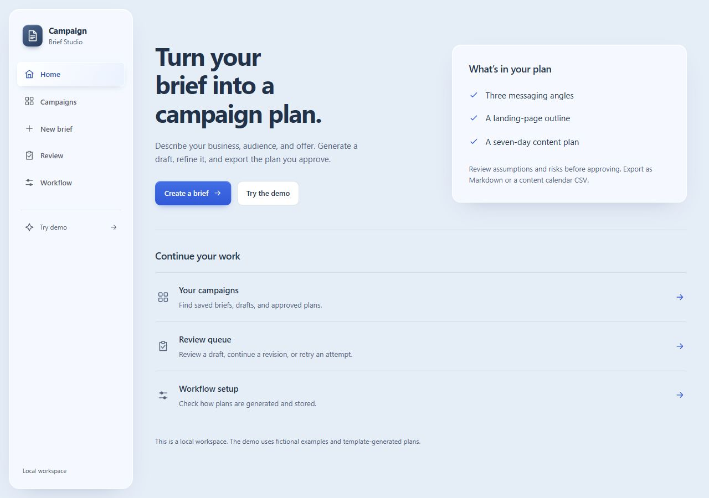
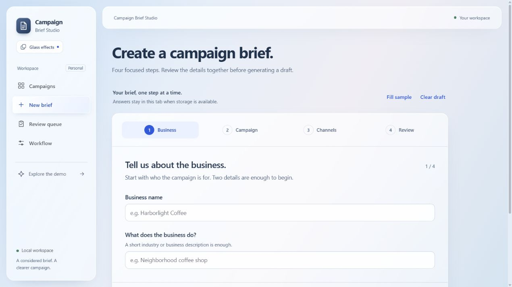
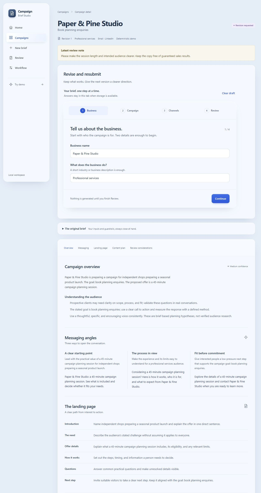
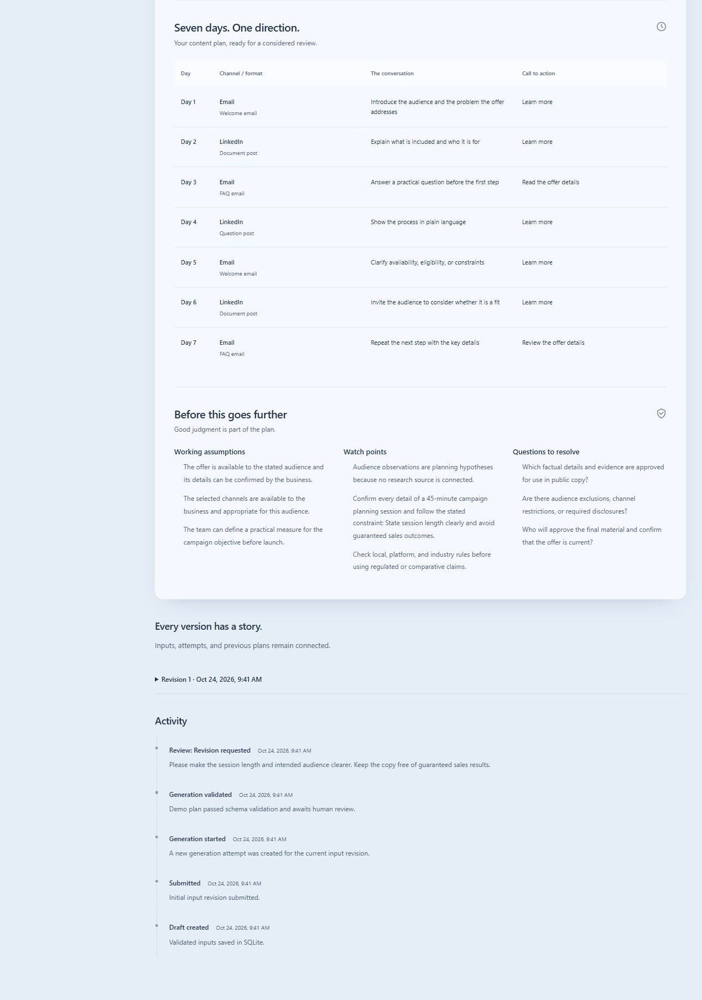
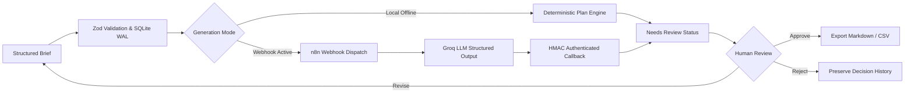

# ✦ Campaign Brief Studio

> **A human-in-the-loop AI marketing workspace & automation engine.**  
> Transforms raw business briefs into validated messaging angles, conversion-focused landing page wireframes, and 7-day multi-channel execution plans.


---



---

## 🎯 At a Glance

Most generative marketing tools produce isolated snippets of unverified copy. **Campaign Brief Studio** treats AI output as an intermediate proposal, placing human judgment and operational safety at the center of the lifecycle.

- **4-Stage Guided Brief Wizard:** Collects company context, campaign direction, audience demographics, and channel strategy with zero fluff.
- **3 Strategic Messaging Angles:** Generates distinct positioning options (e.g., Pain-Relief, Social Proof, Risk-Reversal) for every brief.
- **Full Conversion Blueprint:** Complete landing page outline including headline hierarchies, benefit blocks, trust proof points, and call-to-actions.
- **7-Day Multi-Channel Execution Plan:** Concrete day-by-day scheduling for Email, Social, Paid, and Content marketing.
- **Deliberate Human Review & Revision Gate:** Strict approval safeguards, explicit low-confidence alerts, change requests, and full revision history.
- **Deterministic & Async AI Modes:** Run locally with deterministic offline templates, or connect an asynchronous **n8n + Groq** webhook pipeline.

---

## 📸 Visual Showcase

### 1. Guided Brief Wizard
A focused multi-step questionnaire (`Business → Campaign → Channels → Review`) with auto-saved drafts and tab crash recovery.



### 2. Campaign Strategy & Messaging Angles
Deep-dive into the generated campaign blueprint: audience insights, three distinct positioning angles, and conversion-focused landing page wireframes.



### 3. 7-Day Multi-Channel Calendar & Audit Trail
Actionable day-by-day scheduling across social, email, and content channels — backed by working assumptions, risk watch points, and full revision history.



### 4. Campaign Hub & Lifecycle Queue
Search, filter by status (`Draft`, `Needs review`, `Generating`, `Approved`, `Rejected`), and inspect historical revisions.


### 5. Apple-Inspired Glassmorphism on Any Device
Engineered with frosted glass surfaces, light-catching borders, and responsive reflow tested down to 320px mobile screens.

| Interactive Demo (Desktop) | Mobile Viewport Experience |
|:---:|:---:|
|  |  |

---

## ⚡ Quickstart

### Prerequisites
- **Node.js**: `22.20` or later
- **npm**

### 1. Instant Fictional Preview (Port 3100)
Test drive the studio with pre-seeded fictional campaigns in an isolated sandbox database:

```bash
npm ci
npm run build
npm run preview
```
Open **[http://127.0.0.1:3100](http://127.0.0.1:3100)** or explore the zero-setup client-memory **`/demo`** route directly.

### 2. Local Operator Development (Port 3000)
Run the active workspace with real transactional SQLite persistence:

```bash
Copy-Item .env.example .env.local
npm run dev
```
Open **[http://127.0.0.1:3000](http://127.0.0.1:3000)**. Leaving `N8N_WEBHOOK_URL` blank uses deterministic offline generation — no external API keys needed!

---

## 🏗️ Architecture & Orchestration

Campaign Brief Studio pairs a Next.js App Router frontend with an asynchronous, HMAC-authenticated n8n automation workflow:



### Engineering Highlights

- **Crash & Reload Resilience:** Uncertain submissions preserve their payload and idempotency key in `sessionStorage`. Browser reload replays the committed operation instead of creating duplicate campaigns.
- **HMAC Callback Security:** The callback endpoint verifies dedicated `x-campaign-callback-secret` headers, validates versioned plan envelopes, and rejects stale/expired attempt IDs.
- **Spreadsheet-Safe Exports:** One-click Markdown dossiers and CSV content calendars. CSV exports sanitize formula-injection vectors (`=`, `+`, `-`, `@`) automatically.
- **Zero-Dependency Live Demo:** The `/demo` route runs completely in browser memory, allowing anyone to test brief creation, generation, review, revisions, and exports without a server or database.

---

## 🤖 n8n + Groq Automation Setup

To connect live AI orchestration via n8n:

1. Import [`n8n/campaign-brief-studio.json`](n8n/campaign-brief-studio.json) into your n8n workspace.
2. In the **Campaign webhook** node, configure Header Auth: `x-campaign-webhook-secret` matching `N8N_WEBHOOK_SECRET` in `.env.local`.
3. In the **Groq response** node, set your Groq API Key (`openai/gpt-oss-120b`).
4. In the **Callback result** node, configure Header Auth: `x-campaign-callback-secret` matching `N8N_CALLBACK_SECRET`.
5. Set `CAMPAIGN_CALLBACK_URL` in n8n to `http://127.0.0.1:3000/api/webhooks/generation-complete`.
6. Activate the workflow and submit a brief!

---

## 🛠️ Tech Stack

| Layer | Technology |
| --- | --- |
| **Framework** | Next.js 16 (App Router), React 19, TypeScript 5 |
| **Styling** | Tailwind CSS v4, custom glassmorphism design system |
| **Persistence** | SQLite with WAL mode, transactions, and foreign keys (`better-sqlite3`) |
| **AI Orchestration** | n8n workflow engine with Groq LLM completions |
| **Validation** | Strict schema validation with JSON Schema & TypeScript contracts |
| **Testing** | Node.js native test runner, ESLint 9, strict typechecking |

---

## 🧪 Verification & Quality Suite

Run the full verification battery locally:

```powershell
npm run typecheck         # Strict TypeScript check (0 errors)
npm run lint              # ESLint 9 linting
npm test                  # 33 unit and integration tests
npm run contract:check    # Verifies n8n workflow contract parity
npm run test:production   # Isolated production smoke test
```

---

## 📚 Deep Dive Documentation

- [System Architecture](docs/architecture.md)
- [Design System & Glassmorphism Guidelines](DESIGN.md)
- [Testing & Quality Evidence](docs/testing-checklist.md)
- [Workflow Schema Contract](docs/contract.md)
- [Case Study & Retrospective](docs/case-study.md)
- [Interactive Demo Walkthrough Script](docs/demo-script.md)
- [AI Safety & Operational Limitations](docs/ai-safety-and-limitations.md)

---

*Crafted by [jeushdev](https://github.com/jeushdev) as a showcase of human-in-the-loop AI systems and resilient fullstack engineering.*
