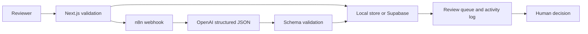

# Architecture

The browser calls Next.js only. The route normalizes required inputs, writes a draft, calls the webhook server-side, validates the returned contract, then moves it to **Needs review**. Local JSON is for development; replace `src/lib/store.ts` with a Supabase adapter for production.
