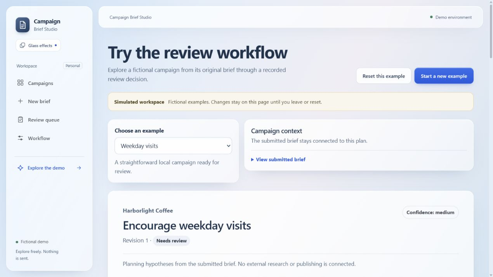
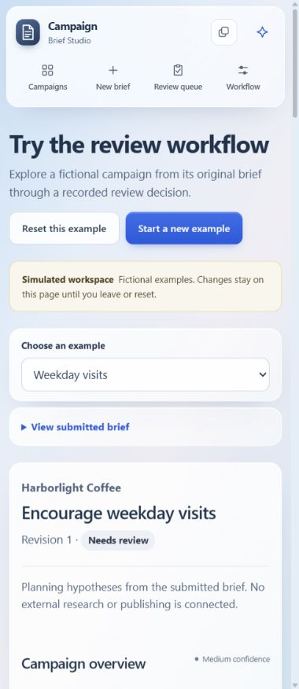

# Campaign Brief Studio

## The problem

A useful marketing plan needs more than generated copy. The team needs to understand the brief, inspect the assumptions, ask for a revision, and know exactly which version was approved. A generation failure should preserve the work already entered.

Campaign Brief Studio explores that workflow in a local software project. It is designed around small marketing teams' tasks, while the current operator application deliberately remains single-user and local. Its fictional demonstration is not evidence of customer adoption or commercial impact.

## The product decision

Keep the full journey visible: brief → generation → review → revision → approval → export. Generated content is an intermediate draft. The operator's judgment is the final step before external use.

The redesign replaces a dense prototype shell with a calm document workspace. Following the user's material direction, a floating glass navigation rail establishes location; grouped frosted form sections make the input manageable; a full-width plan and anchored sections support reading. Crisp navy text and more opaque fields preserve legibility. Brief context is available in a disclosure, preserving space for the strategy. Review actions are deliberate, and previous versions remain inspectable. An appearance switch offers glass or solid surfaces and initially respects reduced-transparency preferences.

The mobile view keeps the same document hierarchy and makes the brief available through a disclosure.

## What changed

| Before | After |
| --- | --- |
| Fixed context column compressed the campaign near tablet widths | Full-width document, collapsible inputs, and content-driven reflow |
| Undifferentiated form and technical validation messages | Grouped fields, suggested/custom channels, meaningful errors, focused recovery |
| Campaign table without discovery tools | Search, status filters, sorting, pagination, and distinct empty states |
| One long output followed by decisions | Section navigation and an explicit review action area with confirmation |
| Clipboard-only action labeled export | Actual Markdown/CSV downloads, copy feedback, metadata, and spreadsheet-formula protection |
| Unauthenticated callback route | Dedicated callback authentication, strict envelope/version validation, bounded delivery attempts |
| Setup required before a reviewer could interact | Fictional client-memory demo plus an isolated seeded local preview |

## Engineering choices

The existing Next.js/TypeScript stack and SQLite contracts were retained. Transactional operations, request identity, attempt ownership, and optimistic versions protect state transitions. Uncertain submissions preserve their original payload/key, including tab reload recovery when session storage is available. Stale callbacks and decisions cannot overwrite newer work.

n8n remains the live generation orchestrator; Groq supplies structured output in that mode. App and workflow validate the result independently. Callback destinations are pinned, secrets remain server-side, and origin/Host checks apply to operator mutations. The public-demo architecture is not implemented by disabling those guards.

The demonstration uses clearly labeled fictional fixtures and local templates. Its edits are separate from submitted snapshots, decisions are recorded in ephemeral history, and exports follow approval. The real operator database and optional notification hooks are outside that client-side flow.

## Evidence

The automated suite covers contracts, provider extraction, persistence/concurrency, callback authentication, stale attempts, safe exports, and reload recovery after a lost create response. A production smoke test exercises the workflow through a local stub. Browser evidence and pending manual gates are recorded in [the verification checklist](testing-checklist.md).

No time-saved, conversion, accuracy, customer, or revenue claim is made. No real provider round trip, deployment, or downstream notification is implied by the deterministic demonstration.

## Next product boundary

Shared real-client operation would require identity, authorization, tenant isolation, delivery guarantees where needed, privacy/retention decisions, and hosting suited to persistent data. That is a separate product milestone. This release completes a local, reviewable portfolio application and a safe fictional demonstration.
