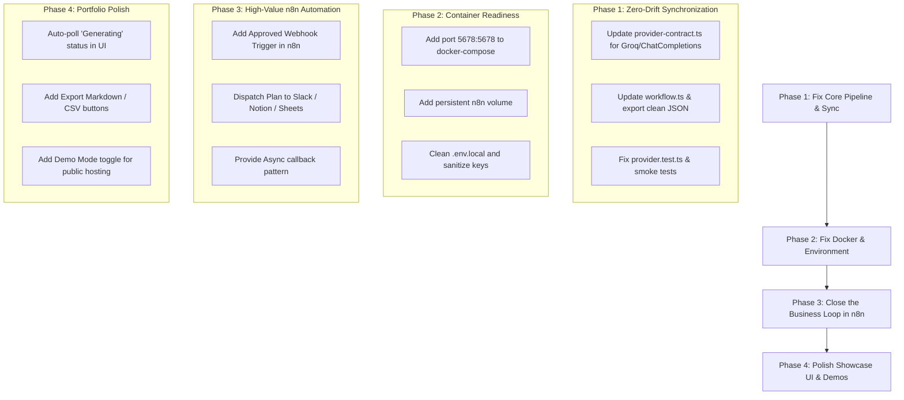

# Architectural & Structural Weakness Audit
**Project:** Campaign Brief Studio  
**Audit Context:** Portfolio Showcase & Realistic Business Problem Simulation  
**Date:** September 2026  

---

## 1. Executive Summary

Campaign Brief Studio demonstrates exceptional discipline in software engineering fundamentals: transactional SQLite integrity with WAL mode, SHA-256 payload idempotency, and contract schema verification between TypeScript and exported workflow code.

However, when evaluated against its primary objective—**a portfolio piece showcasing an n8n automation simulating a real-world business workflow**—the project contains fundamental structural holes, architectural inconsistencies, and deployment breakages. 

This document details all identified weaknesses across six critical categories:
1. **n8n Workflow & Architectural Anti-Patterns**
2. **Contract, Provider & Codebase Inconsistencies**
3. **Deployment, Docker & Environment Breakages**
4. **Portfolio Accessibility & Showcase Limitations**
5. **UI / UX & Operator Lifecycle Gaps**
6. **Business Problem Simulation Fidelity**

---

## 2. n8n Workflow & Architectural Anti-Patterns

### 2.1 The "Dumb Pass-Through Proxy" Dilemma
* **The Weakness:** The n8n workflow operates strictly as a 4-node synchronous HTTP proxy:
  $$\text{Next.js} \xrightarrow{\text{Webhook}} \text{Prepare Request} \xrightarrow{\text{If Valid}} \text{LLM HTTP Call} \xrightarrow{\text{Validate}} \text{Return Result}$$
* **Impact on Portfolio Evaluation:**
  * Anyone evaluating this as an automation showcase will ask: *"Why run an entire self-hosted n8n instance just to forward an HTTP call that Next.js could execute directly in 10 lines of code with lower latency and higher reliability?"*
  * n8n's primary value proposition is heterogeneous system orchestration (connecting databases, CRMs, chat tools, document generators, and notification channels). None of these capabilities are currently utilized.
* **Structural Solution:** Make n8n the orchestration engine for the broader business process:
  * Pre-generation: Query external brand guidelines, scrape competitor landing pages, or fetch CRM context.
  * Post-approval: Push approved campaign calendars into Notion, Airtable, Google Sheets, or Slack.

### 2.2 Synchronous Blocking Webhook vs. Asynchronous Callback
* **The Weakness:** The app holds a synchronous HTTP connection open for up to 45 seconds (`AbortSignal.timeout(45_000)` in `src/lib/webhook.ts`). n8n configures a 35-second timeout on the LLM node.
* **Impact on Reliability:**
  * Complex structured LLM generations (requiring 3 messaging angles, landing page outline, and a 7-day content schedule across multiple channels) frequently experience latency spikes.
  * If the HTTP connection drops mid-generation, Next.js marks the attempt failed, but n8n continues executing, causing wasted inference tokens and orphaned state.
* **Structural Solution:** Enterprise automation standard:
  1. Next.js triggers `POST /webhook/campaign-brief-studio` $\rightarrow$ n8n returns `202 Accepted` immediately with an `executionId`.
  2. Brief enters `Generating` status.
  3. Upon completion, n8n invokes a callback endpoint on Next.js (`POST /api/webhooks/generation-complete`) with signed payload validation.

---

## 3. Contract, Provider & Codebase Inconsistencies

### 3.1 The Groq vs. OpenAI Contract Severance
* **The Weakness:** The exported n8n workflow (`n8n/campaign-brief-studio.json`) was updated to use **Groq** (`api.groq.com/openai/v1/chat/completions` with model `openai/gpt-oss-120b`), but the TypeScript source of truth was left behind.
* **Inconsistencies Caused:**
  1. **Contract Check Failure:** Running `npm run contract:check` fails with `Error: Generated contract is stale: n8n/campaign-brief-studio.json`.
  2. **Overwriting Risk:** Running `npm run contract:export` will completely overwrite the Groq workflow with the legacy OpenAI configuration.
  3. **Failing Unit Tests:** `tests/provider.test.ts` fails because it asserts strict deep equality with `buildWorkflow()`, which still expects the `OpenAI response` node and OpenAI Responses API format.
  4. **Smoke Test Failure:** `scripts/production-smoke.ts` cannot execute the Groq node structure or parse its response format.
  5. **Type Definition Drift:** `src/lib/provider-contract.ts` still explicitly throws `Unsupported provider: groq. Claude is not implemented.` and parses `/v1/responses` format (`output[].content[].type === "output_text"`) rather than Groq's Chat Completions (`choices[0].message.content`).
  6. **UI & Documentation Misrepresentation:** `src/app/settings/page.tsx`, `README.md`, and `docs/architecture.md` all still claim: *"Provider: OpenAI adapter"*.

### 3.2 Bleed of Instance Metadata in Exported Workflow
* **The Weakness:** The exported workflow file contains machine-specific n8n metadata:
  * Local instance ID: `"instanceId": "797ccba0fad1dac4d385b450da84b415fd9754d031537b19e7ce4aa675c4c80a"`
  * Local credential database keys: `"id": "wNIC3KvMw51t1Jiz"` and `"id": "uE9yhPUAW0R7GGO0"`
* **Impact:** Exposing internal credential IDs in a public portfolio repo looks unpolished and can cause credential mapping collisions when imported into another n8n instance.

---

## 4. Deployment, Docker & Environment Breakages

### 4.1 Broken `docker-compose.yml`
* **Weakness A: Missing Port Mapping on n8n:**
  ```yaml
  services:
    n8n:
      image: n8nio/n8n
      env_file:
        - .env.local
  ```
  Port `5678` is never exposed to the host machine. A user running `docker compose up` cannot open `http://localhost:5678` to import workflows or set credentials.
* **Weakness B: No Volume Persistence for n8n:**
  Without `volumes: - n8n_data:/home/node/.n8n`, restarting the container destroys all imported workflows, webhook paths, and stored API keys.
* **Weakness C: Container Networking Loopback Trap:**
  `.env.local` sets `N8N_WEBHOOK_URL=http://localhost:5678/...`. Inside the `campaign-brief-studio` Docker container, `localhost` resolves to the web app container itself, not the `n8n` container. The app fails with `ECONNREFUSED`. In Docker, it must be `http://n8n:5678/...`.

### 4.2 Sensitive Key Leak and Malformed `.env.local`
* **The Weakness:** `.env.local` contains:
  * Line 9: An exposed Groq API key (`GROQ_API_KEY=gsk_...`).
  * Lines 12–28: Raw PowerShell script syntax (`$headers = @{...}`, `Invoke-RestMethod ...`) pasted directly into the environment file.
* **Impact:** Degrades repo hygiene; risk of credential leakage if accidentally committed; causes parsing anomalies in strict environment loaders.

---

## 5. Portfolio Accessibility & Showcase Limitations

### 5.1 Hardcoded Loopback Boundary
* **The Weakness:** `src/lib/local-access.ts` and `src/proxy.ts` enforce:
  ```ts
  /^(localhost|127\.0\.0\.1|\[::1\])(?::\d+)?$/i.test(host)
  ```
  Any request from a public domain or proxy is rejected with `403 Forbidden`.
* **Impact on Portfolio:**
  * **Cannot be hosted live**: A recruiter, hiring manager, or client browsing your portfolio cannot open a deployed URL (on Railway, Render, Fly.io, etc.).
  * Requires reviewers to pull the repo, set up Node/Docker, configure local n8n, and run it themselves. Most reviewers will skip running it locally.

### 5.2 Single-Machine SQLite Coupling
* **The Weakness:** `better-sqlite3` requires local POSIX/Windows file locks.
* **Impact:** Incompatible with serverless platforms (Vercel, Cloudflare Pages, AWS Lambda) without switching to a distributed SQLite provider (such as Turso/libsql).

---

## 6. UI / UX & Operator Lifecycle Gaps

### 6.1 Lack of Real-Time Updates During Generation
* **The Weakness:** When a brief is in `Generating` status, the detail page (`src/app/briefs/[id]/page.tsx`) displays:
  > *"Generation is in progress. Refresh to check the result. An interrupted attempt becomes retryable after two minutes."*
* **Impact:** Forcing a user to manually refresh their browser in 2026 makes the application feel static and unfinished. A lightweight 3-second auto-poll (`router.refresh()`) during the `Generating` state would provide a responsive experience.

### 6.2 Flawed Review Uncertainty Handler
* **The Weakness:** In `src/components/review-controls.tsx`:
  ```tsx
  {mutation.uncertain ? (
    <button disabled={mutation.busy} onClick={() => void decide("Approved")}>
      Retry same decision
    </button>
  ) : ...}
  ```
* **Impact:** If an operator selected **"Rejected"** or **"Revision requested"** and a transient network error triggered `mutation.uncertain`, the recovery button hardcodes `decide("Approved")`. Even though `useMutation` falls back to `pending.current`, hardcoding `"Approved"` in the handler creates a brittle logic conflict.

### 6.3 Post-Approval Dead End
* **The Weakness:** Once a plan reaches `Approved`, the workflow abruptly ends. There is no:
  * "Copy 7-day schedule to clipboard"
  * "Export to Markdown / CSV / JSON"
  * "Dispatch to downstream tools"
* **Impact:** The business simulation feels half-finished. In reality, marketing plans are approved specifically so they can be distributed to execution teams.

---

## 7. Business Problem Simulation Fidelity

| Simulated Business Need | Current App Reality | Gap |
| :--- | :--- | :--- |
| **Marketing Campaign Scoping** | Captures 8 text fields (voice, objective, audience, offer, etc.). | Omits budget, flight dates, target KPI metrics (CPA/ROAS), and asset file attachments. |
| **Multi-Channel Distribution** | Generates a 7-day table with channel labels. | Generates generic post topics without platform-specific copy variants (e.g. character constraints for X, carousel slides for LinkedIn). |
| **Approval Governance** | Binary Approve/Reject with note. | Real teams require role-based multi-tier review (Legal/Compliance approval vs. Marketing sign-off). |

---

## 8. Prioritized Remediation Roadmap


